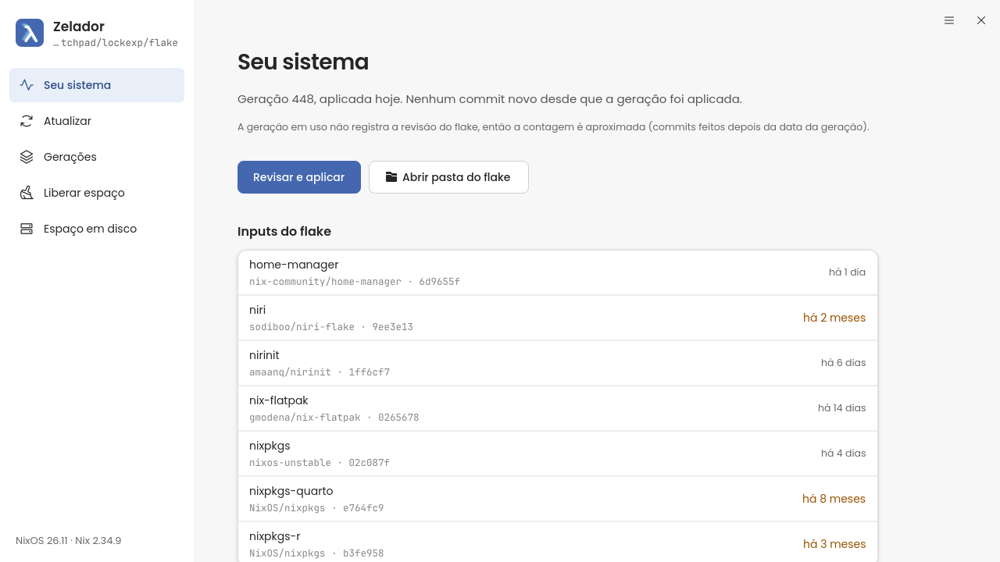
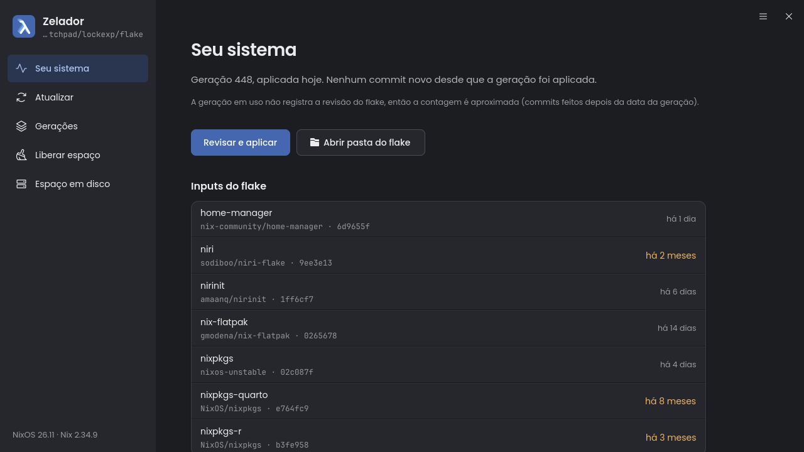
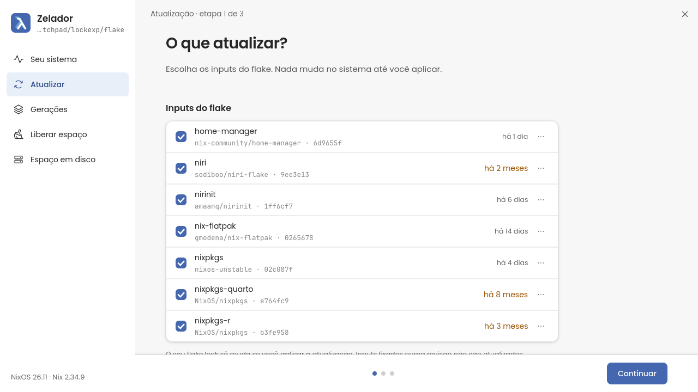
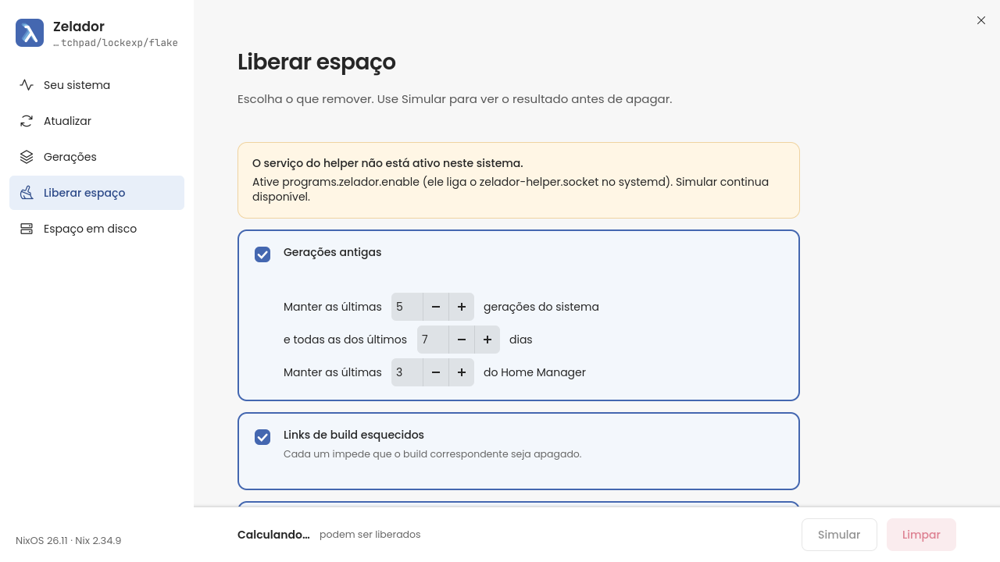
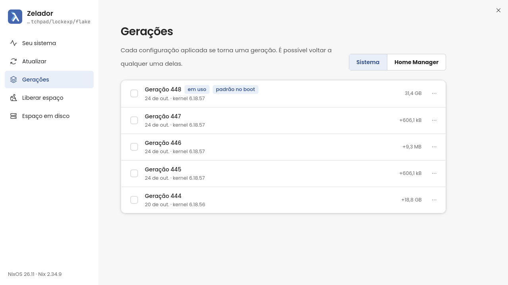
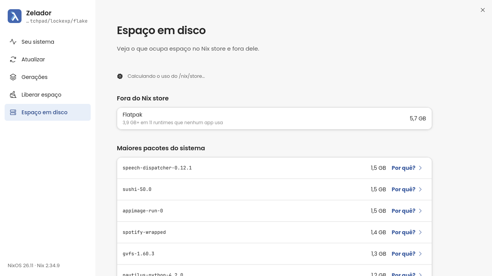

# Zelador

**Painel operacional do NixOS**: atualizar o sistema com revisão antes de aplicar, voltar para uma geração anterior e liberar espaço em disco, tudo numa janela GTK4/libadwaita, sem precisar decorar comandos.

[English version](README.en.md) · [Documentação](docs/) · [Licença MIT](LICENSE)

<p align="center">
  
  
</p>

> **Estado do projeto:** versão 0.1, escrita para uso diário do autor. Testada em `x86_64-linux`, `nixos-unstable` (26.11) e Nix 2.34, com testes automatizados e uma VM NixOS. Veja [Limitações](#limitações) antes de instalar.

## O que é (e o que não é)

O Zelador é uma camada de **operação** sobre as ferramentas que você já usa (`nix`, `git`, `flatpak`, opcionalmente `nvd`). Ele responde às perguntas do dia a dia de quem mantém uma configuração NixOS com flakes:

- *O que mudou desde a última vez que apliquei? Quantos commits ainda não foram para o sistema?*
- *Se eu atualizar os inputs agora, o que muda de verdade? Cabe no meu disco? Vai quebrar?*
- *Qual geração está em uso? Posso voltar para a anterior?*
- *Quanto espaço o Nix está ocupando, e quanto posso liberar sem perder nada que uso?*

Ele **não** é um editor de configuração, uma loja de pacotes, um gerenciador de canais ou de contêineres. Regras que o projeto nunca quebra:

1. **O app nunca edita arquivos `.nix` seus.** O único arquivo do seu flake que ele grava é o `flake.lock`, e só depois de uma atualização aplicada com sucesso.
2. **A interface nunca roda como root.** O que exige privilégio passa por um helper mínimo, com autorização do polkit a cada operação.
3. **Nada destrutivo acontece sem confirmação.** Toda limpeza pode ser simulada antes, e toda ação mostra o que fará.

## Recursos

| Tela | O que faz |
|---|---|
| **Seu sistema** | Geração em uso, quantos commits da configuração ainda não foram aplicados (com aviso quando a contagem é aproximada), idade de cada input do flake, tamanho do `/nix/store`, estado do GC/otimização automáticos e **histórico** das últimas operações. |
| **Atualizar** | Assistente em 3 etapas: escolher inputs (todos, só um, ou fixar numa revisão) → construir **sem privilégio**, com progresso real → revisar as mudanças de pacotes e aplicar (agora, no próximo boot ou "só até reiniciar"). |
| **Gerações** | Lista as gerações do sistema e do Home Manager; compara duas; exclui; volta para uma; torna uma o padrão do boot. |
| **Liberar espaço** | Política de limpeza (manter as últimas N gerações, dias, links `result` esquecidos, runtimes Flatpak sem uso, deduplicação do store), **simulação** e execução com **uma única senha**. |
| **Espaço em disco** | Uso do `/nix/store` por categoria (em uso, pode sair), maiores pacotes e *por que* cada um está no sistema. |
| **Aplicando** | Progresso da ativação, etapa por etapa. A ativação roda numa unidade própria do systemd e continua mesmo que a janela feche. |

Extras: checagem de espaço **antes** do build (bloqueia se faltar disco), tratamento de falha de build (erro relevante, abrir o arquivo com problema, log completo, "tentar de novo sem atualizar o input X"), timer opcional que **só avisa** (inputs velhos, pouco espaço, muito lixo), comparação opcional via `nvd`, tema claro/escuro e traduções (pt-BR e inglês).

<p align="center">
  
  
</p>
<p align="center">
  
  
</p>

## Instalação

Pré-requisitos: NixOS com flakes habilitados (`nix-command flakes`), um agente de autenticação do polkit na sua sessão gráfica (o mesmo que abre a janela de senha em outros apps) e `git` se o seu flake for um repositório.

### Experimentar sem instalar nada

```sh
nix run github:jardel20/Zelador#zelador
```

Sem o módulo instalado o app **abre e lê** o seu sistema, simula limpezas e constrói atualizações, mas as ações privilegiadas (aplicar, voltar, excluir gerações, limpar) ficam desativadas, com um aviso na tela.

### Instalar (módulo NixOS)

No `flake.nix` do seu sistema:

```nix
{
  inputs = {
    nixpkgs.url = "github:NixOS/nixpkgs/nixos-unstable";
    zelador.url = "github:jardel20/Zelador";
    zelador.inputs.nixpkgs.follows = "nixpkgs";
  };

  outputs = { nixpkgs, zelador, ... }: {
    nixosConfigurations.meu-host = nixpkgs.lib.nixosSystem {
      modules = [
        ./configuration.nix
        zelador.nixosModules.default
        { programs.zelador.enable = true; }
      ];
    };
  };
}
```

Depois aplique como de costume (`sudo nixos-rebuild switch --flake .#meu-host`, ou `nh os switch`) e abra o **Zelador** pelo menu de aplicativos ou com `zelador`.

O módulo instala o app, a CLI `zelador-core`, o helper privilegiado, a *action* do polkit, o socket do systemd que ativa o helper, os ícones e as fontes (Poppins e JetBrains Mono). **Não usa `pkexec` nem setuid.** Detalhes e como desfazer em [docs/uso-no-nixos.md](docs/uso-no-nixos.md).

### Opções do módulo

| Opção | Padrão | Para que serve |
|---|---|---|
| `programs.zelador.enable` | `false` | Liga tudo. |
| `programs.zelador.flakePath` | `/etc/nixos` | Pasta do flake observada pelo timer de verificação. |
| `programs.zelador.checkTimer.enable` | `false` | Timer de usuário que verifica e **só avisa** por notificação. |
| `programs.zelador.checkTimer.interval` | `"weekly"` | Quando verificar (`OnCalendar` do systemd). |
| `programs.zelador.checkTimer.staleDays` | `14` | Avisa se um input tem mais dias que isto. |
| `programs.zelador.checkTimer.minFreeGiB` | `10` | Avisa se o espaço livre cai abaixo disto. |
| `programs.zelador.checkTimer.reclaimableGiB` | `20` | Avisa se podem sair mais que isto (0 desliga). |
| `programs.zelador.package` / `cliPackage` / `helperPackage` | pacotes do flake | Para trocar os pacotes. |

## Uso rápido da linha de comando

A CLI `zelador-core` é a mesma lógica da interface, útil para diagnóstico e scripts:

```sh
zelador-core status                 # geração em uso, commits pendentes, inputs, Flatpak
zelador-core space                  # uso do /nix/store por categoria
zelador-core clean                  # SIMULA a limpeza (não altera nada)
zelador-core clean --execute --yes  # executa (pede a senha de administrador uma vez)
zelador-core update                 # constrói a atualização sem aplicar
zelador-core check --notify         # o que o timer faz
zelador-core history                # últimas operações
```

Use `--flake <pasta>` e `--host <nome>` para apontar para outro flake. `zelador-core --help` lista tudo.

## Como funciona, em uma página

```
┌────────────────────┐   sem privilégio        ┌──────────────────────┐
│ zelador (GTK4)     │ ──────────────────────▶ │ nix, git, flatpak,   │
│ janela, telas      │  build, leitura, diff   │ nvd (opcional)       │
└─────────┬──────────┘                         └──────────────────────┘
          │ zelador-helper --call <pedido>
          ▼
┌────────────────────┐  socket de /run/zelador  ┌─────────────────────────┐
│ socket do systemd  │ ───────────────────────▶ │ zelador-helper --serve  │
└────────────────────┘   (root, 1 por conexão)  │ valida → polkit → roda  │
                                                └─────────────────────────┘
```

- **`zelador-core`** (biblioteca + CLI) faz todo o trabalho que não precisa de privilégio: lê gerações, GC roots, tamanhos, `flake.lock`, `git`, Flatpak; calcula estimativas; monta planos; interpreta o progresso do Nix.
- **`zelador-gtk`** (o app) só apresenta e orquestra. Nenhuma operação longa roda na thread da interface.
- **`zelador-helper`** é o único código com privilégio. Aceita **somente** um conjunto fechado de subcomandos (`activate`, `rollback`, `set-boot-default`, `delete-generations`, `gc`, `optimise`, `flatpak-remove-unused` e o agregado `clean`), valida tudo por conta própria e confere o polkit a cada pedido.

A explicação completa está em [docs/arquitetura.md](docs/arquitetura.md); o modelo de segurança em [docs/seguranca.md](docs/seguranca.md).

## Limitações

- **Testado só em `x86_64-linux` com `nixos-unstable`.** `aarch64-linux` está declarado no flake, mas nunca foi construído nem testado.
- **Depende de saídas das CLIs** (`nix`, `nvd`, `flatpak`). Elas são cobertas por fixtures reais, mas mudanças de formato em versões futuras podem exigir ajustes (o projeto trata isso atualizando a fixture e o teste, não "consertando o parser às cegas").
- **A estimativa de espaço é um limite superior.** O Nix informa o tamanho lógico dos caminhos, que ignora arquivos compartilhados por hardlink; o app limita pelo uso real do disco, mas o valor exato só se conhece depois de limpar.
- **Precisa de um agente do polkit.** Sem ele, as ações privilegiadas são recusadas (e o app mostra o motivo).
- **A notificação do timer** usa `notify-send`; depende de o seu daemon de notificações aceitá-lo.
- **A tradução para o inglês** foi feita por IA e não foi revisada por uma pessoa. Correções são bem-vindas.
- **Atualizar pode quebrar a sua configuração** se um input novo remover opções que você usa. O Zelador constrói **antes** de aplicar justamente para mostrar isso como erro de build, sem tocar no sistema.

## Desenvolvimento

```sh
nix develop            # cargo, GTK4, libadwaita, nvd, gettext, fontes
cargo test --workspace
cargo clippy --workspace --all-targets -- -D warnings
nix build .#checks.x86_64-linux.helper-vm   # teste do helper numa VM NixOS (precisa de KVM)
```

Veja [docs/desenvolvimento.md](docs/desenvolvimento.md) para a estrutura do código, fixtures, screenshots headless e traduções.

## Documentação

- [docs/arquitetura.md](docs/arquitetura.md): como cada parte funciona, fluxo por fluxo.
- [docs/seguranca.md](docs/seguranca.md): modelo de ameaças e as defesas do helper.
- [docs/uso-no-nixos.md](docs/uso-no-nixos.md): instalar, configurar e desfazer.
- [docs/desenvolvimento.md](docs/desenvolvimento.md): compilar, testar, contribuir.
- [SPEC.md](SPEC.md) e [design/](design/): a especificação original e a identidade visual.

## Créditos e licença

MIT, veja [LICENSE](LICENSE). Ícones [Phosphor](https://phosphoricons.com) (MIT) embutidos no binário; fontes Poppins e JetBrains Mono (SIL OFL) instaladas pelo módulo. Construído sobre `nix`, `libadwaita`, `gtk4-rs`, `rusqlite` e muito trabalho da comunidade NixOS.
